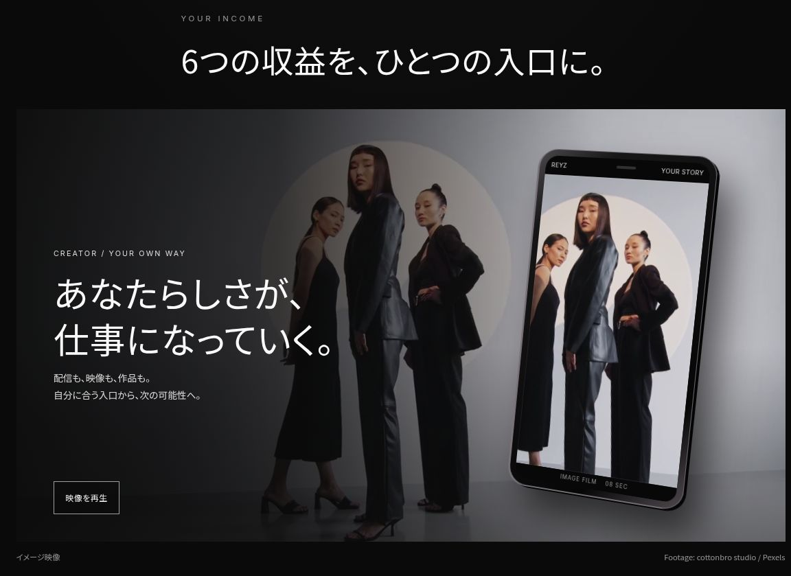
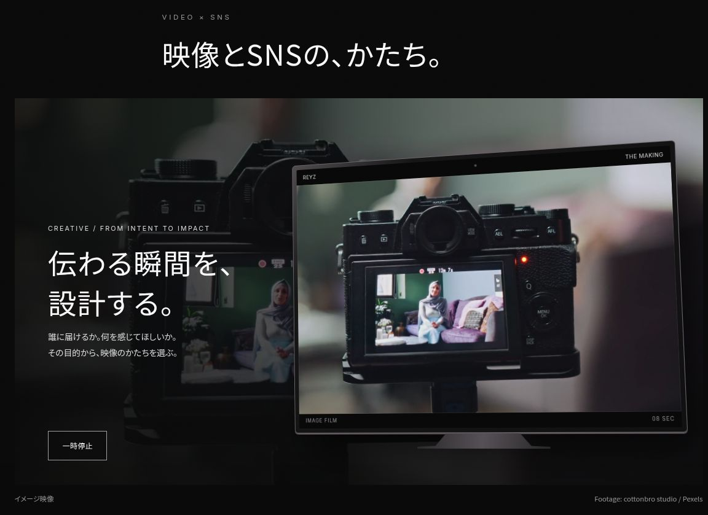

# 2026-11-18 サイト改修の実画面

同じ改修候補のブラウザ表示をそのまま保存したレビュー画像です。デザイン画像をブラウザの外で合成したものではありません。

- PC: Cloud Browserで実ページを表示し、節の見出し・映像・出典を含む範囲を撮影。
- スマホ: 390px幅のChromiumとWebKitで操作・再生・表示幅を検査。全証跡はCIのqa-reportに含まれます。
- 映像はcottonbro studio / Pexelsのイメージ映像です。REYZの顧客実績・人物の推薦ではありません。出典は[media-sources.md](../../media-sources.md)。
- フルサイクル、料金、映像の検査は423判定合格（2026-11-18実行）。全必須CIの最終結果はPR #59のチェックを参照してください。

## クリエイター / PC

## 企業 / PC

